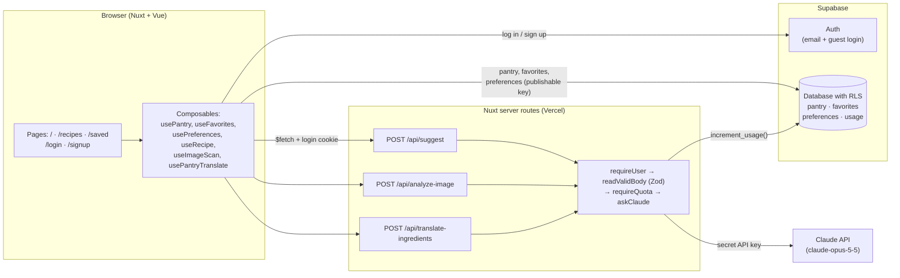
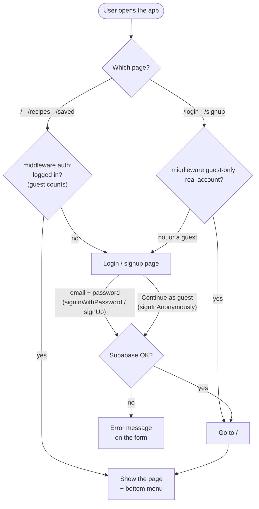
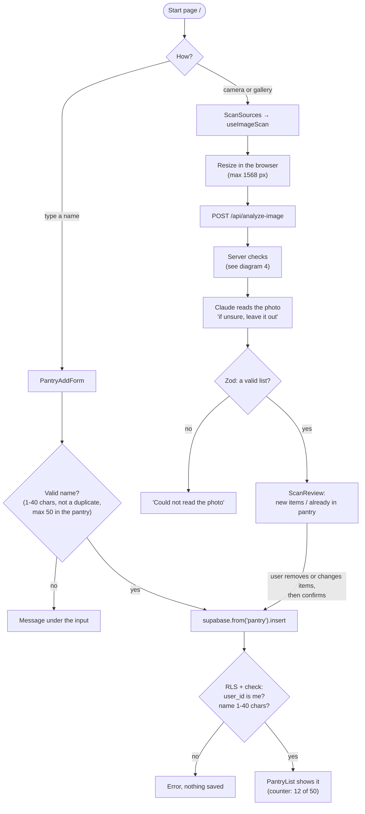
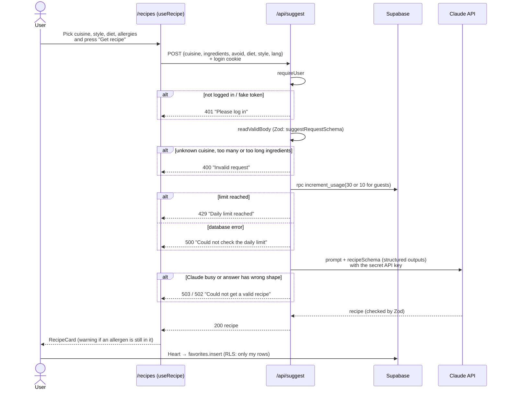
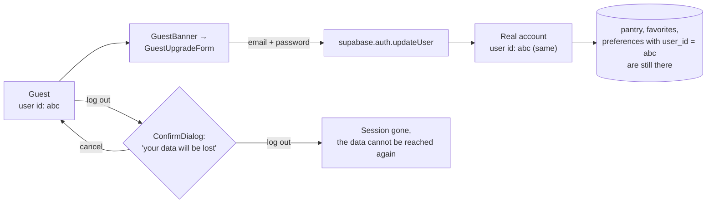

# How the app works (flow charts)

Five diagrams, from the big picture to the details. GitHub shows them as
pictures (Mermaid).

1. [The big picture](#1-the-big-picture)
2. [Login and pages](#2-login-and-pages)
3. [Ingredients: by hand or by photo](#3-ingredients-by-hand-or-by-photo)
4. [Getting a recipe](#4-getting-a-recipe)
5. [Guest to real account](#5-guest-to-real-account)

## 1. The big picture

The browser talks to Supabase directly for the user's own data (protected by
RLS), and to our own server for everything that needs the Claude API key.

## 2. Login and pages

Two route middlewares decide who may see which page.

## 3. Ingredients: by hand or by photo

Typed ingredients go straight to the database. A photo goes through the server
and Claude first, and the user checks the list before anything is saved.

## 4. Getting a recipe

The order on the server matters: bad requests stop before they use up the daily
limit, and nothing reaches Claude before all checks pass.

The browser turns each status code into a message in the chosen language
(app/utils/apiErrorKey.ts).

## 5. Guest to real account

`updateUser` adds an email and a password to the guest's user. The user id
stays the same, so every row that points to it stays too.

